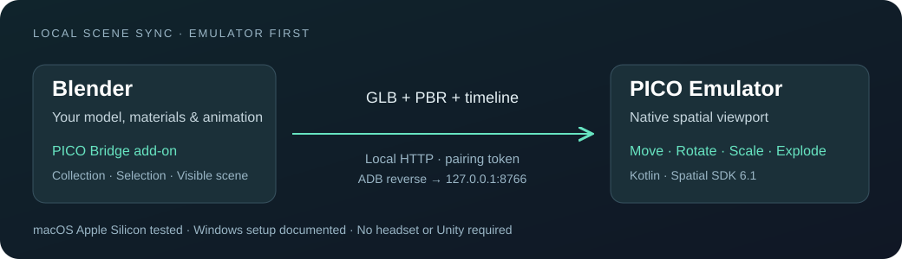

# Blender → PICO Bridge

Bring Blender models into a spatial room in the PICO Emulator. The Blender add-on publishes your geometry, materials and timeline; the PICO app lets you move, rotate, scale and explode the model. An optional transparent render window streams Blender’s actual viewport, including stereo views.



**v0.8.0 · Development preview · MIT · Emulator-first**

[Install & run](#install-and-run) · [First Blender Cube in Room](#4-run-your-first-blender-cube-in-room-mode) · [Render streaming](#optional-render-window) · [Experimental device setup](#experimental-running-on-a-compatible-device) · [Troubleshooting](docs/TROUBLESHOOTING.md) · [Build from source](docs/DEVELOPMENT.md)

The walkthrough below uses one computer for Blender and **PICO OS 6.1 Emulator**. macOS Apple Silicon has been exercised; Windows setup is documented and the APK includes x86-64 libraries, but Windows runtime testing remains outstanding. No physical device is needed.

## What you need

| Install | Purpose | Get it |
| --- | --- | --- |
| Blender | Run the add-on and publish your scene | [Blender download](https://www.blender.org/download/) · tested with **5.2.2 LTS** |
| PICO Emulator | Run the spatial viewer | **OS 6.1**; [Mac / Windows downloads below](#standalone-pico-emulator-downloads) |
| Android Platform-Tools (`adb`) | Install the APK and connect the emulator to Blender | [Official macOS / Windows packages](https://developer.android.com/tools/releases/platform-tools) |
| Bridge add-on ZIP + viewer APK | Install one on each end | [Download v0.8.0](https://github.com/mixedworld/blender-pico-bridge/releases/tag/v0.8.0) |

You do **not** need Unity, PICO Connect, Blender MCP, an AI agent, Android Studio or a compiler to run the packaged bridge. An external **Python 3.10+** environment is needed only for optional render streaming. Building the APK from source additionally needs JDK 21 and Android SDK 35; see [development instructions](docs/DEVELOPMENT.md).

## Install and run

### 1. Download the bridge packages

Download these files from the **same [v0.8.0 release](https://github.com/mixedworld/blender-pico-bridge/releases/tag/v0.8.0)**:

- [pico_blender_bridge-0.8.0.zip](https://github.com/mixedworld/blender-pico-bridge/releases/download/v0.8.0/pico_blender_bridge-0.8.0.zip) — Blender add-on. **Keep this ZIP zipped.**
- [blender-pico-bridge-debug.apk](https://github.com/mixedworld/blender-pico-bridge/releases/download/v0.8.0/blender-pico-bridge-debug.apk) — PICO app, with ARM64 and x86-64 libraries.
- [SHA256SUMS](https://github.com/mixedworld/blender-pico-bridge/releases/download/v0.8.0/SHA256SUMS) — file checksums.
- [third-party-notices.zip](https://github.com/mixedworld/blender-pico-bridge/releases/download/v0.8.0/third-party-notices.zip) — dependency licenses.

[render-worker-setup.zip](https://github.com/mixedworld/blender-pico-bridge/releases/download/v0.8.0/render-worker-setup.zip) is optional; the native Cube walkthrough does not need it. The APK is a debug-signed development build, not a store release.

### 2. Install the Blender add-on

1. Open Blender.
2. Go to **Edit → Preferences → Add-ons**.
3. Open the menu at the top right of the Add-ons page and choose **Install from Disk…**.
4. Choose `pico_blender_bridge-0.8.0.zip`, then enable **PICO Blender Bridge**. If upgrading, stop the existing bridge/stream first, install the new ZIP and restart Blender after saving your own work.
5. Close Preferences. Move the mouse into Blender’s **3D Viewport** and press **N** (or use **View → Sidebar**).
6. Click the vertical **PICO Bridge** tab in that sidebar. The panel inside is called **PICO Blender Bridge**.

The add-on uses Blender’s bundled glTF exporter. No Python packages need to be installed inside Blender.

### 3. Start the emulator and install the viewer

#### Standalone PICO Emulator downloads

Get **PICO OS 6.1 Emulator** from [PICO’s official resources page](https://developer.picoxr.com/resources/). Direct standalone packages, checked on **18 October 2026**:

- [macOS Apple Silicon / ARM ZIP](https://lf-developer.picovr.com/obj/spatial-toolbox-mycis/oversea/emulator_original_packages/pico_oversea_emulator_20260902_mac.zip) — about 3.0 GB.
- [Windows ZIP](https://lf-developer.picovr.com/obj/spatial-toolbox-mycis/oversea/emulator_original_packages/pico_oversea_emulator_20260902_win.zip) — about 3.6 GB.

Extract the **entire emulator ZIP** to a writable folder, leaving its executable, system images and configuration together. This ZIP is separate from the Blender add-on ZIP.

| Host | Start the emulator |
| --- | --- |
| macOS Apple Silicon | Open Terminal in the extracted folder containing `start-emulator.sh`, then run `bash start-emulator.sh`. |
| Windows | Open the extracted folder and run `start-emulator.bat` (PowerShell: `.\start-emulator.bat`). |

Wait until the PICO home environment is fully loaded. Vendor standalone launcher execution and Windows runtime have not been tested here; if setup fails, follow the [PICO CLI installation/start route](docs/DEVELOPMENT.md#provision-the-emulator-with-pico-cli), which is the route exercised on this Mac. See also [PICO’s emulator guide](https://developer.picoxr.com/document/pico-cli/emulator-guide/). No Intel Mac standalone package is listed.

If you already use PICO CLI, list your existing emulators with `pico-cli emulator list`, then start the actual AVD name with `pico-cli emulator start --avd YOUR_AVD_NAME`. Reuse that name for subsequent starts.

#### Install the APK

Extract Android Platform-Tools and put its `platform-tools` folder on your terminal’s **PATH**. Alternatively invoke the full path to `adb` / `adb.exe`. Open a terminal in the folder containing the downloaded APK and run:

```sh
adb devices
```

Find the online emulator serial. The examples use `emulator-5554`; substitute the serial shown on your machine:

```sh
adb -s emulator-5554 install -r blender-pico-bridge-debug.apk
adb -s emulator-5554 shell am start -n com.example.blenderpicobridge.p7f82b4c1/.platform.LaunchActivity --ez inspection_room true
```

These commands work in macOS Terminal and Windows PowerShell when `adb` is on PATH. With a local Windows executable, use `.\adb.exe`; with a local Mac executable use `./adb`. Wait for **Success** from installation. The app should open in **Room**; if it opens in Preview, choose **Room** in the toolbox. A connection warning is expected until Blender is paired.

Blender may have a different PATH from Terminal. If needed, set **Edit → Preferences → Add-ons → PICO Blender Bridge → ADB executable** to the actual `platform-tools/adb` (`adb.exe` on Windows).

### 4. Run your first Blender Cube in Room mode

1. In Blender, start with the default **General** scene containing the Cube. If necessary use **File → New → General**, saving your own work first. No downloaded sample model is required.
2. For a comfortable first Room view, select the Cube and press **S**, type **0.25**, then press **Enter**. This makes it roughly 0.5 m across rather than the default 2 m. Applying scale is not required for this example.
3. In the 3D Viewport, press **N → PICO Bridge** and set **Source → Visible Scene**. Cameras and lights are excluded from the native model export.
4. The bridge starts automatically if **Start when panel opens** is enabled. Otherwise click **Start Bridge**. If **Stop Bridge** is visible, it is already running. Wait for **Published … objects · … MB**; click **Refresh Model** if necessary.
5. Choose **Connect via → USB / Emulator (ADB)**, then click **Connect / Reconnect Emulator**. The emulator must already be running and the APK installed. Keep only the intended emulator running for this button.
6. Blender restores ADB reverse forwarding, passes its current pairing details and reopens the viewer in **Room**. No QR scan or token entry is required. Wait for **Live from Blender** and the Cube in the room. If Preview is selected, click **Room**.
7. Move your viewpoint using the emulator’s navigation controls. Use **Tools → Model → Scale** to manipulate the Cube with supported input. **100% source** restores source size; **Assemble** restores separated parts. Use **Hide tools** and the small **Tools** button to hide/recall the toolbox.
8. Change the Cube in Blender, for example **S → 1.2 → Enter**. With **Sync model edits** enabled, the viewer updates. **Refresh Model** explicitly republishes it. A single Cube has no separate parts to explode and no animation; try a multi-object or animated scene afterwards.

**Success:** Blender says **Headset connected** (the label also covers the emulator), the app says **Live from Blender**, and the Cube is visible in **Room**. You do not need to align a monitor, stage a take, enable camera access or set up streaming for this first sample.

Room uses source scale; **Preview** is the alternate bounded volume with automatic fitting. If a previously saved viewport alignment stages the model behind a mask, pinch through the frame and pull it out; **Stage for take** intentionally hides a staged model behind that frame.

### Everyday startup and manual fallback

After setup: start the emulator → open Blender and its PICO Bridge panel → **USB / Emulator (ADB) → Connect / Reconnect Emulator**. Use that button again after an emulator restart; forwarding is not persistent. It reopens the viewer, retaining saved alignment while resetting temporary session controls. Opening another `.blend` stops the old bridge; check that the new one has started and reconnect.

If you prefer manual pairing, keep Blender’s bridge running, click **Copy Pairing Details**, then restore forwarding:

```sh
adb -s emulator-5554 reverse tcp:8766 tcp:8766
```

In the app choose **Tools → Connection → Manual connection**, enter `http://127.0.0.1:8766` and the token from the second copied line, then click **Connect**. Use your configured port if it differs from 8766. The loopback address refers to Blender through ADB reverse, not to a server running inside the emulator.

## Toolbox navigation

The toolbox has **Model**, **Render**, **Align** and **Connection** tabs. The selected tab names the page; scrolling stays within that page. A scroll indicator and **Scroll for more** hint show when controls continue below.

When no scene is connected, only pairing controls are shown. Scan Blender’s **current** QR or choose **Manual connection**. Each scan waits for fresh camera frames; move your head slightly if prompted. Expired pairing clears the saved token. A sustained bridge connection loss clears the virtual model and video, then returns to pairing. Normal model revisions and brief network interruptions retain your setup.

Pinch the toolbox’s native movement handle to reposition the panel. Closing it or choosing **Hide tools** leaves the small **Tools** launcher available. Pinch its **Pinch here to move** grip to reposition the launcher. In Room, **Model → Bring Tools launcher here** recalls it near your current viewpoint. The optional **Palm Tools shortcut** shows a Tools button beside your little finger after looking toward a steady open palm; it opens the same toolbox. It defaults off; live hand tracking and physical comfort still need headset verification.

Use **Align → Adjust corner handles** for the recommended viewport alignment. Marker, touch and depth alternatives are under **Align → Experimental calibration**. Align to Blender’s **3D viewport image boundary**, excluding panels and the monitor bezel.

## Optional render window

The native model path above transfers geometry. To see Blender’s actual shading, add a movable transparent video surface:

1. Install external [Python 3.10+](https://www.python.org/downloads/), download `render-worker-setup.zip` from the release, and **extract it**.
2. In a terminal in that extracted folder, run `python3 tools/setup_render_worker.py` on Mac or `py -3 tools/setup_render_worker.py` in Windows PowerShell. The helper downloads the encoder dependencies and prints its Python interpreter path. If needed, paste that path into Blender’s **Preferences → Add-ons → PICO Blender Bridge → Render worker Python**.
3. In Blender’s PICO Bridge panel, enable **Allow PICO viewport control** for Scene-aligned mode, choose **Stream appearance** and click **Start viewport stream**. Keep that 3D Viewport open.
4. In PICO **Room → Tools → Render**, enable **Show render window**. Choose **Scene-aligned** for a window into the model, or **Live display** to show Blender’s current view.
5. Optionally enable **Face user → Fit to model** in Scene-aligned mode. The plane follows a bounding sphere around the model and stays in front when space permits; close to the model, eye clearance permits intersection. **Lock render window** prevents frame grabs. Otherwise grab its border/corners to move or resize it; centre grabs pass through to the model.

Cycles, Eevee, Workbench, Solid, Material Preview and Wireframe are supported with engine-specific limits. Optional **Stereo (manual IPD)** uses explicitly entered eye separation; Mono is the default. **Show 3D model** can hide native rendering while keeping model interaction available. Native part explosion is not reproduced in the streamed Blender image; use **Assemble** for an aligned comparison.

Read [direct-stream setup](docs/DIRECT_STREAMING.md), [render-window controls](docs/RENDER_WINDOW.md) and [stereo setup](docs/STEREO_STREAMING.md). Native materials approximate supported glTF/viewport colours; the render stream provides Blender’s actual image. No Chrome or Mac screen sharing is required.

**Render → Hide render border** controls decoration only: video and model interaction stay active. With **Scene-aligned → Face user + Fit to model**, the border automatically hides. An explicit visibility choice overrides that default; **Use automatic border** restores automatic behavior. Lock the render window to make every grab pass through it.

## Experimental: running on a compatible device

In theory, the same APK and Room workflow can run on a compatible physical device with the required PICO Spatial runtime, just as they do in the emulator. This is an experimental path, not a claim of support for a particular device. Hardware-specific availability, permissions, input and performance may differ.

1. Enable developer/USB debugging using the device’s own instructions. Connect by USB, approve the debugging prompt and find its serial with `adb devices`.
2. Install and launch the **same release APK**, substituting its serial for `DEVICE_SERIAL`:

```sh
adb -s DEVICE_SERIAL install -r blender-pico-bridge-debug.apk
adb -s DEVICE_SERIAL reverse tcp:8766 tcp:8766
adb -s DEVICE_SERIAL shell am start -n com.example.blenderpicobridge.p7f82b4c1/.platform.LaunchActivity --ez inspection_room true
```

3. In Blender select **USB / Emulator (ADB)** and use **Copy Pairing Details**. In the device app’s Connection panel, manually enter `http://127.0.0.1:8766` and the current token. The **Connect / Reconnect Emulator** button deliberately targets emulators only; use the commands above for a physical device.
4. Alternatively, put both ends on the same reachable private LAN, select **Wi-Fi / LAN** in Blender and enter its displayed URL/token in the app. If supported, **Show large pairing QR → Connection → Scan Blender QR** replaces manual entry; grant Camera only when using scanning. Allow the local server through the host firewall on the private network.
5. Enter **Room** and follow the Cube walkthrough. Spatial data permission may be needed for anchor-based saved alignment; camera/depth tools are optional experiments and are not required for manual model viewing.

For viewport extraction, use [five-handle alignment](docs/QR_ALIGNMENT.md#manual-alignment-with-five-handles): put four cyan handles on **Blender’s 3D viewport image corners**, not the monitor bezel, and the amber handle at the top centre for curvature. Then **Stage for take → Lock alignment** and pinch through the frame to pull the model out. Physical viewport linking and transparent/stereo streaming require their own validation; emulator results do not establish device performance.

## Limits and troubleshooting

- Native export uses glTF-compatible materials and image maps. Procedural materials, complex deformation and simulations may need baking. Native PBR and Workbench colour approximations are not a pixel-identical Blender render.
- A GLB download is limited to **200 MB**. Large scenes, imports and high-quality rendering can be slow.
- Inspection transforms stay in the viewer. Viewport linking adjusts a temporary Blender camera; it does not edit authored object transforms. Independent displays are not frame-locked.
- Emulator webcam hands are experimental. Select eye-hand mode and enable **Settings → Labs → Hand Tracking** if available. Use the vendor’s navigation/input controls otherwise.
- For **Connection lost**, use Blender’s reconnect button. For a missing tab, enable the add-on. For `adb` errors, check its path and emulator serial. See [Troubleshooting](docs/TROUBLESHOOTING.md).
- Windows runtime, physical binocular compositing, sustained performance and complete visual-design fidelity remain unverified. See [validation scope](docs/VALIDATION.md).

## Source, security and licenses

[Build from source](docs/DEVELOPMENT.md) · [Protocol](PROTOCOL.md) · [Contributing](CONTRIBUTING.md) · [Security](SECURITY.md)

```text
blender-addon/   Blender add-on, exporter, HTTP server and capture
native-app/      Kotlin/PICO Spatial app and runtime occlusion asset
editor-asset/    Public authored occlusion source
tools/         Packaging, setup and development helpers
tests/         Python regression tests
docs/          Setup, usage and validation notes
```

The bridge uses a bearer token over **unencrypted local HTTP**. Use ADB reverse or a trusted private network; do not expose its port to the internet or share tokens in public `.blend` files, screenshots or logs. Pairing via ADB uses Android intent extras on a trusted development computer. There is no general remote-Python execution endpoint.

Original project code is [MIT licensed](LICENSE). Blender, PICO and other dependencies retain their own terms; see [third-party notices](THIRD_PARTY_NOTICES.md). No vendor installers, third-party demo models, private pairing files or room recordings are bundled. Product names identify compatibility and do not imply endorsement.
